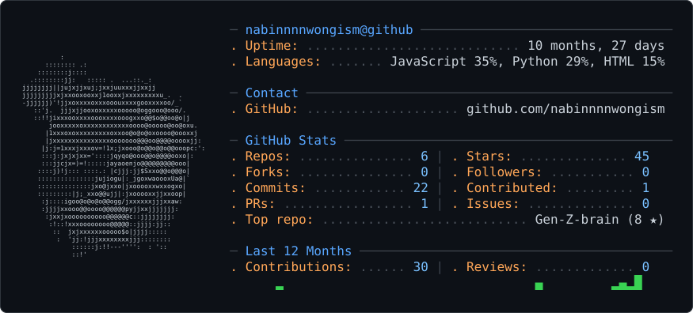
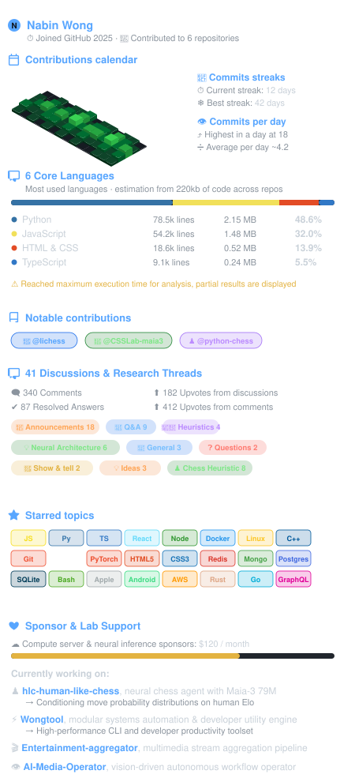
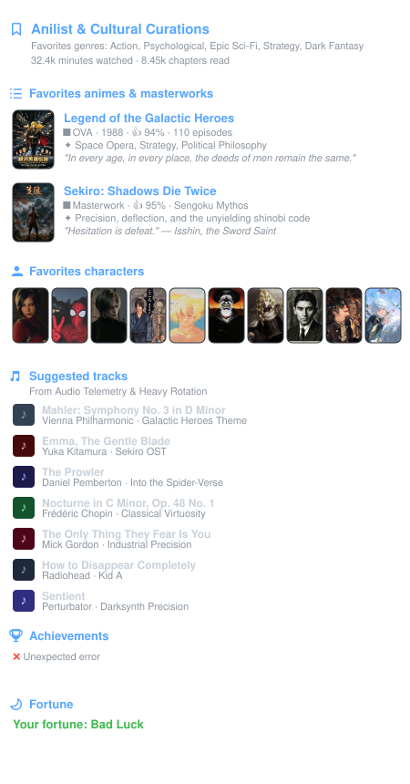
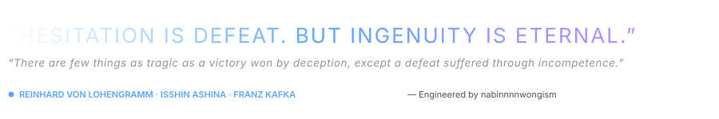

# Hi, I'm [Nabin Wong](https://github.com/nabinnnnwongism)

<picture>
  <source media="(prefers-color-scheme: dark)" srcset="dark_mode.svg" />
  <source media="(prefers-color-scheme: light)" srcset="light_mode.svg" />
  
</picture>

---

> **Autonomous Systems & Neural Behavioral Architecture** · *Pioneering cognitive heuristics and distributed tooling.*
>
> - 🧠 **Core Research**: Neural chess agent conditioned on human Elo distributions ([`hlc-human-like-chess`](https://github.com/nabinnnnwongism/hlc-human-like-chess))
> - ⚡ **Systems Utility**: High-performance modular developer engine ([`Wongtool`](https://github.com/nabinnnnwongism/Wongtool))
> - ♟️ **Live Bot**: Running on Lichess as an autonomous BOT account [`@MyHLCBot`](https://lichess.org/@/MyHLCBot)

<table>
  <tr>
    <td width="50%" valign="top">
      
    </td>
    <td width="50%" valign="top">
      
    </td>
  </tr>
</table>

  

Infographics inspired by <a href="https://github.com/lowlighter/metrics">lowlighter/metrics</a> and engineered for <a href="https://github.com/nabinnnnwongism">nabinnnnwongism</a>.
